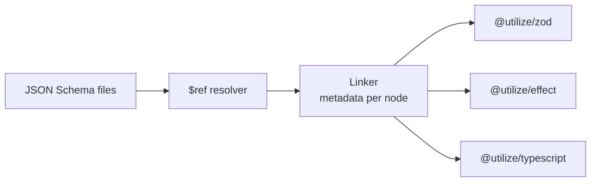

# Utilize Schema

**Convert JSON Schema to Zod, Effect Schema, or plain TypeScript.** Local,
external and cyclic `$ref` links resolve into standalone schemas, and draft-04
through 2020-12 are supported.

[](https://github.com/MatejBransky/utilize-schema/actions/workflows/check.yml)
[](https://www.npmjs.com/package/@utilize/zod)
[](./LICENSE)

<details>
<summary>Table of contents</summary>

- [Quick start](#quick-start)
- [Features](#features)
- [Packages](#packages)
- [Usage](#usage)
- [Playground](#playground)
- [Architecture](#architecture)
- [Supported features](#supported-features)
- [Recursive schemas](#recursive-schemas)
- [Contributing](#contributing)
- [License](#license)

</details>

<a id="quick-start"></a>

## ⚡ Quick start

One JSON Schema file in, a Zod schema with matching types out:

```sh
pnpm add zod
pnpm add -D @utilize/zod
utilize-zod user.json user.zod.ts
```

Input (`user.json`):

```json
{
  "$schema": "https://json-schema.org/draft/2020-12/schema",
  "type": "object",
  "properties": {
    "email": { "type": "string", "format": "email" },
    "role": { "enum": ["admin", "member"], "default": "member" },
    "age": { "type": "integer", "minimum": 18 },
    "address": { "$ref": "#/$defs/address" }
  },
  "required": ["email", "role"],
  "additionalProperties": false,
  "$defs": {
    "address": {
      "type": "object",
      "properties": { "city": { "type": "string" } },
      "required": ["city"]
    }
  }
}
```

Output (`user.zod.ts`, banner omitted):

```ts
import { z } from 'zod';

export const Address = z.object({
  city: z.string(),
});
export type Address = z.infer<typeof Address>;

export const User = z.strictObject({
  email: z.email().meta({ format: 'email' }),
  role: z.enum(['admin', 'member']).default('member'),
  age: z.int().min(18).optional(),
  address: Address.optional(),
});
export type User = z.infer<typeof User>;
```

The `$ref` becomes a standalone `Address` schema emitted before the schema that
uses it. Names come from `$id`/`title`, the definition key, or the file name.
Constraints survive the trip: `format: "email"` becomes
`z.email().meta({ format: 'email' })` by default and
`z.string().meta({ format: 'email' })` with `formatMode: 'annotate'`, `default` →
`.default()`, `additionalProperties: false` → `z.strictObject`.

<details>
<summary>Same schema, Effect Schema and TypeScript</summary>

`user.effect.ts`:

```ts
import { Schema } from 'effect';

const formatEmail = Schema.isPattern(
  new RegExp('^[^\\s@]+@[^\\s@]+\\.[^\\s@]+$', 'u')
);

export const Address = Schema.StructWithRest(
  Schema.Struct({ city: Schema.String }),
  [Schema.Record(Schema.String, Schema.Json)]
);

export type Address = typeof Address.Type;

export const User = Schema.StructWithRest(
  Schema.Struct({
    email: Schema.String.check(formatEmail).annotate({ format: 'email' }),
    role: Schema.Literals(['admin', 'member']).annotate({ default: 'member' }),
    age: Schema.optionalKey(
      Schema.Int.check(Schema.isGreaterThanOrEqualTo(18))
    ),
    address: Schema.optionalKey(Schema.suspend(() => Address)),
  }),
  [Schema.Record(Schema.String, Schema.Json)]
).check(
  Schema.makeFilter((value) =>
    Object.keys(value).every((key) =>
      ['email', 'role', 'age', 'address'].includes(key)
    )
      ? undefined
      : 'Unexpected property'
  )
);

export type User = typeof User.Type;
```

`user.ts`:

```ts
export interface Address {
  city: string;
  [key: string]: unknown;
}

export interface User {
  /**
   * @format email
   */
  email: string;
  /**
   * @default "member"
   */
  role: 'admin' | 'member';
  age?: number;
  address?: Address;
}
```

</details>

---

<a id="features"></a>

## ✨ Features

- **Three targets, one pipeline.** `@utilize/zod`, `@utilize/effect` and
  `@utilize/typescript` share the same parser and linker. Adding a target means
  writing one generator.
- **`$ref` links resolve.** Local, external, `$id`/`$anchor` and cyclic.
  External documents are read from disk, fetched over HTTP, or served from
  memory with `externalSchemas`. Each generator handles cycles its own way: Zod
  uses getters or `z.lazy()`, Effect Schema emits `Schema.suspend`, TypeScript
  emits recursive interfaces.
- **Every definition is standalone.** `$defs` and `definitions` each get their
  own schema or type. Zod also orders them by dependency; Effect Schema and
  TypeScript emit references lazily, so their order does not matter.
- **Rename the output.** Pass a callback to rewrite schema and type names, for
  example to suffix every schema with `Schema`.
- **Format is a choice.** Both runtime generators validate known formats by
  default and keep `format` as metadata with `formatMode: 'annotate'`; Zod's
  `formatMap` overrides individual formats with your own expression.
- **Dialect-aware.** Draft-04/06/07 are read natively, 2019-09 and 2020-12 are
  normalized. `$schema` is resolved per schema resource, not once per file, the
  runtime generators apply `$ref` siblings only where the dialect defines them,
  and keywords outside the dialect are reported as warnings instead of being
  applied silently. See [docs/dialects.md](./docs/dialects.md).
- **Types without runtime.** `@utilize/typescript` emits interfaces and aliases
  only, with no dependency to install.

Conformance is measured against the official JSON Schema Test Suite for every
supported dialect. Numbers and remaining gaps are in
[Supported features](#supported-features), and each package README shows a
conformance badge per dialect.

---

<a id="packages"></a>

## 📦 Packages

| Package                                          | Version                                                                                                         | Downloads                                                                                                              | Coverage                                                                               | Conformance                                                                                              | What it does                                                                                               |
| ------------------------------------------------ | --------------------------------------------------------------------------------------------------------------- | ---------------------------------------------------------------------------------------------------------------------- | -------------------------------------------------------------------------------------- | -------------------------------------------------------------------------------------------------------- | ---------------------------------------------------------------------------------------------------------- |
| [`@utilize/json-schema`](./packages/json-schema) | [](https://www.npmjs.com/package/@utilize/json-schema) | [](https://www.npmjs.com/package/@utilize/json-schema) | [](CONTRIBUTING.md#coverage-badge) | —                                                                                                        | Resolves `$ref` and links nodes with metadata. The generator-agnostic pipeline the three targets build on. |
| [`@utilize/zod`](./packages/zod)                 | [](https://www.npmjs.com/package/@utilize/zod)                 | [](https://www.npmjs.com/package/@utilize/zod)                 | [](CONTRIBUTING.md#coverage-badge)         | [](./packages/zod/README.md#testing)                   | Emits Zod schemas and `z.infer` types.                                                                     |
| [`@utilize/effect`](./packages/effect)           | [](https://www.npmjs.com/package/@utilize/effect)           | [](https://www.npmjs.com/package/@utilize/effect)           | [](CONTRIBUTING.md#coverage-badge)      | [](./packages/effect/README.md#testing)             | Emits Effect Schema codecs and types, with every `$ref` going through `Schema.suspend`.                    |
| [`@utilize/typescript`](./packages/typescript)   | [](https://www.npmjs.com/package/@utilize/typescript)   | [](https://www.npmjs.com/package/@utilize/typescript)   | [](CONTRIBUTING.md#coverage-badge)  | [](./packages/typescript/README.md#conformance) | Emits interfaces and type aliases. No runtime dependency.                                                  |

The coverage badge is the unit test line coverage of that package's `src`,
including the JSON Schema Test Suite and the CLI entry points. It is committed
to `.github/badges/`, regenerated with `pnpm badge:coverage` and checked in CI;
see [CONTRIBUTING.md](./CONTRIBUTING.md#coverage-badge).

The conformance badge is the share of compatible JSON Schema Test Suite cases
where every expected result matches, for draft-07. Each package README shows a
badge for every measured dialect — draft-04, draft-06, draft-07, 2019-09 and
2020-12 — with known gaps left in the denominator. The badges are committed to
`.github/badges/`, regenerated with `pnpm badge:suite` and checked in CI; see
[CONTRIBUTING.md](./CONTRIBUTING.md#conformance-badges).

The runtime generators need their runtime as a peer dependency: `zod`
(`>=4.5.0 <5`) and `effect` (`>=4.0.0 <5`).

```sh
pnpm add zod effect
```

---

<a id="usage"></a>

## 📖 Usage

### Programmatic API

```ts
import { compile as compileZod } from '@utilize/zod';
import { compile as compileEffect } from '@utilize/effect';
import { compile as compileTypescript } from '@utilize/typescript';

await compileZod({
  input: './schema.json',
  output: './schema.zod.generated.ts',
});

await compileEffect({
  input: './schema.json',
  output: './schema.effect.generated.ts',
});

await compileTypescript({
  input: './schema.json',
  output: './schema.generated.ts',
});
```

### Options

```ts
await compileZod({
  input: './schema.json',
  output: './schema.zod.generated.ts',
  formatMode: 'annotate',
  externalSchemas: {
    'https://example.com/address.json': {
      type: 'object',
      properties: { city: { type: 'string' } },
      required: ['city'],
    },
  },
});
```

`externalSchemas` serves a document from memory instead of reading it from disk
or the network, and is available on all three generators. Known formats are
validated by default; `formatMode: 'annotate'` keeps `format` as metadata
instead. Both runtime generators take `formatMode`, and Zod also maps individual
formats with `formatMap`.

### CLI

All three generators ship a CLI that accepts a file, directory or glob, reads
JSON and YAML, and writes to a file, a directory or stdout:

```sh
utilize-zod schema.json schema.generated.ts
utilize-effect --input 'schemas/**/*.json' --output generated/
utilize-typescript --input 'schemas/**/*.yaml' --output generated/
cat schema.yaml | utilize-zod > schema.generated.ts
```

Generated files start with a "do not edit" banner (`--no-banner` omits it).
Both runtime generators take `--format-mode annotate|assert`, Zod also takes
`--readonly`, and both runtime CLIs expose the dialect flags (`--dialect`,
`--fallback-dialect`, `--keyword-policy`). See each package README for the
remaining flags.

---

<a id="playground"></a>

## 🧪 Playground

<p align="center">
  
</p>

<details>
<summary>Watch the drag-and-drop demo (20 s)</summary>

<p align="center">
  
</p>

</details>

The [`playground`](./playground) is a browser app for editing multiple JSON
Schema files with references. Switch between the Zod, Effect Schema and
TypeScript generators, change the keyword policy and the format mode, and watch
the generated code and validation update live.

- Hosted: <https://matejbransky.github.io/utilize-schema/>
- Every pull request gets its own Vercel preview deployment.

---

<a id="architecture"></a>

## 🏗 Architecture



1. **$ref resolver** resolves every reference: local, external, cyclic.
2. **Linker** annotates each node with metadata (parent, referenced schema, path,
   dialect).
3. **Generators** emit code and types for every standalone schema.
4. **Target specifics** differ where the languages do. Zod breaks cycles with
   getters or `z.lazy()` and derives value types. Effect Schema emits every
   reference through `Schema.suspend` and annotates only the schemas that take
   part in a cycle. The TypeScript generator emits recursive interfaces directly,
   because TypeScript needs no annotation.

---

<a id="supported-features"></a>

## ✅ Supported features

The Zod and Effect Schema generators accept the same input and are checked
against each other by a differential test suite
(`packages/effect/test/parity.test.ts`), so the table below is kept honest by
CI. All three generators are also checked against the official JSON Schema Test
Suite for draft-07:

- **Zod:** 283 of 304 cases (1,399 of 1,655 assertions) pass.
  [Known gaps](./packages/zod/test/suite/knownFailures.ts)
- **Effect Schema:** 286 of 304 cases (1,400 of 1,655 assertions) pass.
  [Known gaps](./packages/effect/test/suite/knownFailures.ts)
- **TypeScript:** 191 of 285 cases pass at the type level, with 81 type gaps.
  [Baseline](./packages/typescript/test/suite/baseline.ts) ·
  [Known gaps](./packages/typescript/test/suite/knownGaps.ts)

<details>
<summary>How the three numbers add up</summary>

All three generators start from the same draft-07 subset. [The loader](./packages/zod/test/suite/loadSuite.ts)
reads the top-level `validation/tests` files of the pinned suite and keeps a
case when its `compatibility` allows draft-07, which leaves 304 of 613 cases
(`optional/` and `proposals/` are not loaded).

| Step                        | Zod | Effect Schema | TypeScript |
| --------------------------- | --- | ------------- | ---------- |
| draft-07 cases in the suite | 304 | 304           | 304        |
| − `format-assertion` cases  | —   | —             | 19         |
| **= cases run**             | 304 | 304           | 285        |
| − known gaps                | 21  | 18            | 13         |
| − type-level gaps           | —   | —             | 81         |
| **= cases passing**         | 283 | 286           | 191        |

The runtime generators measure both format groups: `format-annotation` cases
compile with `formatMode: 'annotate'` and `format-assertion` cases with
`formatMode: 'assert'`, so all 304 draft-07 cases run. A type cannot check a
format either way, so the TypeScript generator skips the 19 `format-assertion`
cases instead. The 16 cases that need `externalSchemas` run against the
documents the suite provides. The skip rule for each target is in its suite
runner
([Zod](./packages/zod/test/jsonSchemaTestSuite.test.ts),
[Effect Schema](./packages/effect/test/jsonSchemaTestSuite.test.ts),
[TypeScript](./packages/typescript/test/jsonSchemaTestSuite.test.ts)).

The 81 type gaps are cases where an invalid instance is rejected only by a
keyword a type cannot express (`minimum`, `pattern`, `format`, …);
[`baseline.ts`](./packages/typescript/test/suite/baseline.ts) records that count
next to the 191 conformant cases. Every other gap is an explicit entry with a
reason, so fixing one or introducing a regression changes the count and fails
the suite instead of drifting silently.

Assertions add up the same way, because one instance is one assertion:

| Step                        | Zod   | Effect Schema |
| --------------------------- | ----- | ------------- |
| instances in draft-07 cases | 1,655 | 1,655         |
| − failing                   | 256   | 255           |
| **= passing**               | 1,399 | 1,400         |

The type-level runner reports accepted and rejected instances separately instead
of a pass count; those numbers are in [docs/conformance.md](./docs/conformance.md).

</details>

The TypeScript generator has no runtime: validation keywords such as
`minLength`, `pattern` or `uniqueItems` have no type-level equivalent, so they
are ignored. Its runner emits every suite instance as a typed constant and
checks the whole set with one `tsc` pass. The rest are type-only gaps, the
inference trade-off shared with json-schema-to-typescript, or shared parser
gaps. See
[`packages/typescript/README.md`](./packages/typescript/README.md#conformance)
for the full numbers and methodology.

| JSON Schema Keyword                          | Zod | Effect Schema | Notes                                                                                 |
| -------------------------------------------- | --- | ------------- | ------------------------------------------------------------------------------------- |
| `type`                                       | ✅  | ✅            | Full support, including unions of types                                               |
| `enum`                                       | ✅  | ✅            | Both compare structured values deeply; JSON types stay distinct                       |
| `const`                                      | ✅  | ✅            | Both compare structured values deeply; JSON types stay distinct                       |
| `default`                                    | ✅  | ✅            | Zod decodes with `.default()`; Effect stores it as an annotation                      |
| `description` / `title` / `deprecated`       | ✅  | ✅            | Zod `.meta({})`, Effect `.annotate({})`                                               |
| `readOnly`                                   | ✅  | —             | Zod `.readonly()` with `readOnlyKeyword`; Effect keeps it as an annotation            |
| `minimum` / `maximum`                        | ✅  | ✅            | Supported                                                                             |
| `exclusiveMinimum` / `exclusiveMaximum`      | ✅  | ✅            | Supported (boolean draft-04 form included)                                            |
| `multipleOf`                                 | ✅  | ✅            | Supported                                                                             |
| `minLength` / `maxLength`                    | ✅  | ✅            | Effect counts code points, like JSON Schema                                           |
| `pattern`                                    | ✅  | ✅            | Zod `.regex()`, Effect `Schema.isPattern`                                             |
| `format`                                     | ✅  | ✅            | Asserted by default; `formatMode: 'annotate'` keeps it as metadata                    |
| `properties`                                 | ✅  | ✅            | Supported                                                                             |
| `required`                                   | ✅  | ✅            | Supported                                                                             |
| `additionalProperties`                       | ✅  | ✅            | Zod `z.strictObject`/`.catchall`, Effect keeps excess keys and filters them           |
| `minProperties` / `maxProperties`            | ✅  | ✅            | Counted on the input, so undeclared keys count too                                    |
| `patternProperties`                          | ✅  | ✅            | Every matching pattern is validated, then `additionalProperties` applies              |
| `propertyNames`                              | ✅  | ✅            | Supported                                                                             |
| `items`                                      | ✅  | ✅            | Supported                                                                             |
| `prefixItems`                                | ✅  | ✅            | 2020-12 syntax, also via the tuple form of `items`                                    |
| `additionalItems`                            | ✅  | ✅            | Supported                                                                             |
| `uniqueItems`                                | ✅  | ✅            | Key-order-insensitive comparison                                                      |
| `contains`                                   | ✅  | ✅            | Supported                                                                             |
| `minContains` / `maxContains`                | ✅  | ✅            | Counted with `contains` in 2019-09 and newer                                          |
| `dependencies`                               | ✅  | ✅            | Also covers `dependentRequired` and `dependentSchemas`                                |
| `allOf`                                      | ✅  | ✅            | Zod intersects any schemas; Effect merges object/scalar/array parts, filters the rest |
| `anyOf`                                      | ✅  | ✅            | Supported                                                                             |
| `oneOf`                                      | ✅  | ✅            | Zod requires exactly one match; Effect uses the exclusive union mode                  |
| `not`                                        | ✅  | ✅            | Supported                                                                             |
| `if` / `then` / `else`                       | ✅  | ✅            | Supported                                                                             |
| `discriminator`                              | ✅  | —             | Zod emits a discriminated union; Effect ignores the annotation                        |
| `$ref`                                       | ✅  | ✅            | Local, external, cyclic and `$id`/`$anchor` based; boolean targets supported          |
| `$defs` / `definitions`                      | ✅  | ✅            | Supported                                                                             |
| `$id` / `$anchor`                            | ✅  | ✅            | Establishes the base URI and resolves fragment identifiers                            |
| `examples`                                   | ✅  | ✅            | Kept as metadata                                                                      |
| `$schema`                                    | ✅  | ✅            | Detects draft-04/06/07/2019-09/2020-12 and normalizes newer keywords                  |
| `unevaluatedProperties` / `unevaluatedItems` | ✅  | ✅            | Mapped to `additionalProperties` / the items rest (best effort)                       |

`✅` supported, `❌` rejected with a clear error, `—` accepted but only kept as
an annotation.

The table covers the two runtime generators; keyword coverage for the TypeScript
generator is in its README (`packages/typescript/README.md#keyword-coverage`).

A schema without `type` gets one branch per constrained type (object, array,
string or number), so constraints such as `{ pattern }` or `{ required }` are
not silently dropped, and `{ minLength: 2, minimum: 5 }` checks both strings and
numbers while still accepting every other JSON type.

2020-12 `prefixItems` maps to the tuple form of `items`, and
`dependentRequired`/`dependentSchemas` map to `dependencies`. `unevaluatedProperties`
and `unevaluatedItems` map to `additionalProperties` / the items rest when those
are not set, which covers schemas that do not rely on properties evaluated by
applicators. The runtime generators intersect `$ref` siblings in 2019-09 and
2020-12, and ignore them in draft-07 and older, as those dialects define.
Unknown `$schema` values fall back to draft-07. 2019-09/2020-12 keywords without
a generator (`$recursiveRef`, `$dynamicRef`) fail with
`UnsupportedSchemaFeatureError`.

---

<a id="recursive-schemas"></a>

## 🔁 Recursive schemas

The generators support self-referencing and mutually recursive schemas, but
they express the recursion differently.

**Zod** emits getters for recursion inside object properties:

```ts
type TreeValue = { name: string; children?: TreeValue[] };
export const Tree: z.ZodType<TreeValue> = z.object({
  name: z.string(),
  get children() {
    return z.array(Tree).optional();
  },
});
export type Tree = z.infer<typeof Tree>;
```

Cycles that cannot be deferred with a getter (array items, tuples, records and
recursive `additionalProperties`) are emitted as `z.lazy()` together with a
generated value type. A cycle that only passes through unions or aliases has no
value type TypeScript can express recursively, so generation fails with
`UnsupportedCyclicReferenceError` instead of emitting code that does not
type-check.

**Effect Schema** always emits references as lazy schemas, so no dependency
ordering is needed. Schemas that take part in a cycle get a value type and an
explicit annotation, because an inferred `typeof X.Type` would reference itself
and collapse to `any`:

```ts
type TreeValue = { name: string; children?: ReadonlyArray<TreeValue> };

export const Tree: Schema.Codec<TreeValue> = Schema.StructWithRest(
  Schema.Struct({
    name: Schema.String,
    children: Schema.optionalKey(Schema.Array(Schema.suspend(() => Tree))),
  }),
  [Schema.Record(Schema.String, Schema.Json)]
);

export type Tree = typeof Tree.Type;
```

**TypeScript** emits the recursive type directly, because interfaces and
deferred aliases can refer to themselves:

```ts
export interface Tree {
  name: string;
  children?: Array<Tree>;
  [key: string]: unknown;
}
```

A cycle that only passes through aliases, unions or intersections (for example
`type A = A | string`) has no type TypeScript can express, so generation fails
with `UnsupportedCircularTypeError` instead of emitting code that does not
compile.

---

<a id="contributing"></a>

## 🛠 Contributing

- Clone the repo, run `pnpm install`
- Run tests: `pnpm test`
- Run the full check: `pnpm verify`

The full guide, including changesets and release steps, is in
[CONTRIBUTING.md](./CONTRIBUTING.md) and [RELEASING.md](./RELEASING.md).

---

<a id="license"></a>

## 📄 License

MIT. See [LICENSE](./LICENSE).

---

## 🙏 Credits

Inspired by [json-schema-to-typescript](https://github.com/bcherny/json-schema-to-typescript)
and the Zod community. [`@utilize/typescript`](./packages/typescript) is a
drop-in alternative to it, built on the same parser as the runtime generators.
