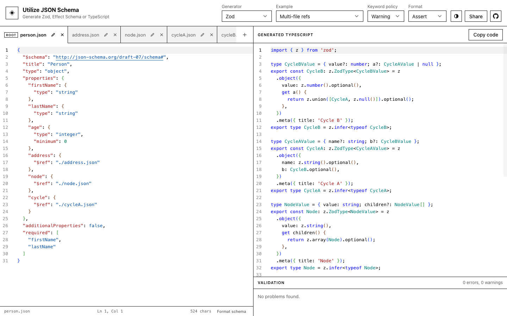
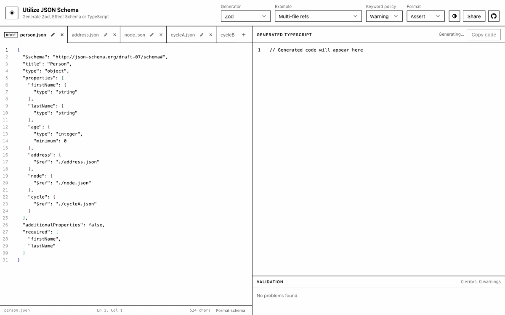

# Utilize Schema

**Convert JSON Schema to Zod, Effect Schema, or plain TypeScript.** One parser
resolves local, external and cyclic `$ref` links into standalone schemas and
types for every dialect from draft-04 to 2020-12.

[](https://github.com/MatejBransky/utilize-schema/actions/workflows/check.yml)
[](CONTRIBUTING.md#what-fallow-enforces-here)
[](https://www.npmjs.com/package/@utilize/zod)
[](./LICENSE)

<details>
<summary>Table of contents</summary>

- [Features](#features)
- [Quick start](#quick-start)
- [Packages](#packages)
- [Usage](#usage)
- [Playground](#playground)
- [Supported features](#supported-features)
- [Learn more](#learn-more)
- [Contributing](#contributing)
- [License](#license)

</details>

<a id="features"></a>

## ✨ Features

- **Three targets, one pipeline.** `@utilize/zod`, `@utilize/effect` and
  `@utilize/typescript` share the same parser, linker and naming rules, so they
  agree on what a schema means.
- **`$ref` links resolve.** Local, external and cyclic, including `$id` and
  `$anchor`. External documents come from disk, HTTP, or memory with
  `externalSchemas`.
- **Every definition is standalone.** `$defs` and `definitions` each get their
  own schema or type. Zod also orders them by dependency.
- **Dialect-aware.** Draft-04/06/07 are read natively, 2019-09 and 2020-12 are
  normalized. `$schema` is resolved per schema resource and `$ref` siblings are
  applied only where the dialect defines them.
- **Proven on the official suite.** Draft-07 scores 283/304 cases for Zod,
  286/304 for Effect Schema and 191/285 for TypeScript; five dialects are
  measured. See [supported features](#supported-features).
- **Types without runtime.** `@utilize/typescript` emits interfaces and aliases
  only; the output imports nothing.

---

<a id="quick-start"></a>

## ⚡ Quick start

```sh
pnpm add -D @utilize/zod
pnpm add zod
utilize-zod user.json user.zod.ts
```

`user.json`:

```json
{
  "$schema": "https://json-schema.org/draft/2020-12/schema",
  "type": "object",
  "properties": { "email": { "type": "string", "format": "email" } },
  "required": ["email"],
  "additionalProperties": false
}
```

`user.zod.ts` (banner omitted):

```ts
import { z } from 'zod';

export const User = z.strictObject({
  email: z.email().meta({ format: 'email' }),
});
export type User = z.infer<typeof User>;
```

The same three steps work for the other targets: `@utilize/effect` with
`utilize-effect`, and `@utilize/typescript` with `utilize-typescript` (no runtime
dependency). See [Usage](#usage) for the API, options and CLI.

---

<a id="packages"></a>

## 📦 Packages

- **[@utilize/json-schema](./packages/json-schema)** — Resolves `$ref` and links nodes with metadata. The generator-agnostic pipeline the three targets build on.

  [](https://www.npmjs.com/package/@utilize/json-schema)
  [](https://www.npmjs.com/package/@utilize/json-schema)
  [](CONTRIBUTING.md#coverage-badge)

- **[@utilize/zod](./packages/zod)** — Emits Zod schemas and `z.infer` types.

  [](https://www.npmjs.com/package/@utilize/zod)
  [](https://www.npmjs.com/package/@utilize/zod)
  [](CONTRIBUTING.md#coverage-badge)
  [](./packages/zod/README.md#testing)

- **[@utilize/effect](./packages/effect)** — Emits Effect Schema codecs and types, with every `$ref` going through `Schema.suspend`.

  [](https://www.npmjs.com/package/@utilize/effect)
  [](https://www.npmjs.com/package/@utilize/effect)
  [](CONTRIBUTING.md#coverage-badge)
  [](./packages/effect/README.md#testing)

- **[@utilize/typescript](./packages/typescript)** — Emits interfaces and type aliases. No runtime dependency.

  [](https://www.npmjs.com/package/@utilize/typescript)
  [](https://www.npmjs.com/package/@utilize/typescript)
  [](CONTRIBUTING.md#coverage-badge)
  [](./packages/typescript/README.md#conformance)

The badges are committed to `.github/badges/` and checked in CI. Coverage is the
line coverage of each package's `src`, including the JSON Schema Test Suite and
the CLI entry points ([coverage badges](./CONTRIBUTING.md#coverage-badge)). The
conformance badge counts draft-07 suite cases where every expected result
matches; each package README shows every measured dialect — draft-04, draft-06,
draft-07, 2019-09 and 2020-12 — with known gaps left in the denominator
([conformance badges](./CONTRIBUTING.md#conformance-badges)). Regenerate both
with `pnpm badge:coverage` and `pnpm badge:suite`.

---

<a id="usage"></a>

## 📖 Usage

### Programmatic API

```ts
import { compile as compileZod } from '@utilize/zod';

await compileZod({
  input: './schema.json',
  output: './schema.zod.generated.ts',
});
```

`@utilize/effect` and `@utilize/typescript` export the same `compile`. All three
accept `externalSchemas` to serve a document from memory instead of disk or the
network; the runtime generators also take `formatMode`, and Zod maps individual
formats with `formatMap`. Each package README documents the full options.

### CLI

```sh
utilize-zod schema.json schema.generated.ts
utilize-effect --input 'schemas/**/*.json' --output generated/
utilize-typescript --input 'schemas/**/*.yaml' --output generated/
cat schema.yaml | utilize-zod > schema.generated.ts
```

The CLIs read JSON and YAML, take a file, directory or glob, and write a file,
directory or stdout. Generated files start with a "do not edit" banner
(`--no-banner` omits it); `--format-mode`, `--dialect`, `--fallback-dialect` and
`--keyword-policy` work across the targets and are listed in the package READMEs.

---

<a id="playground"></a>

## 🧪 Playground

<p align="center">
  
</p>

The [`playground`](./playground) is a browser app for editing multiple JSON
Schema files with references. Switch between the three generators, change the
keyword policy and the format mode, and watch the generated code update live.
A test-data editor below the schemas runs the selected generator's validator and
shows the decoded value, defaults included, or every issue with its JSON path;
the TypeScript target emits types only, so the pane says there is no runtime
validator.

- Hosted: <https://matejbransky.github.io/utilize-schema/>
- Every pull request gets its own Vercel preview deployment.

<details>
<summary>Watch the demo (20 s)</summary>

<p align="center">
  
</p>

</details>

---

<a id="supported-features"></a>

## ✅ Supported features

Both runtime generators implement the validation keywords, including
`$ref`/`$defs`, `allOf`/`anyOf`/`oneOf`, conditionals, `patternProperties` and
`unevaluated*` (best effort). The exceptions are annotations a target cannot
enforce, such as `readOnly` in Effect Schema or `discriminator`; the full table
is in [docs/keywords.md](./docs/keywords.md).

The TypeScript generator has no runtime, so validation keywords such as
`minLength`, `pattern` or `uniqueItems` have no type-level equivalent and are
ignored. Use Zod or Effect Schema when you need runtime validation.

Draft-07 numbers from the official suite, with every measured dialect pinned in
the package baselines:

- **Zod:** 283 of 304 cases (1,399 of 1,655 assertions).
- **Effect Schema:** 286 of 304 cases (1,400 of 1,655 assertions).
- **TypeScript:** 191 of 285 cases at the type level (793 of 972 instances).

---

<a id="learn-more"></a>

## 📚 Learn more

- [Architecture](./docs/architecture.md) — the parser, the linker and the three
  generators.
- [Recursive schemas](./docs/recursion.md) — how each target expresses cycles.
- [Keyword coverage](./docs/keywords.md) — every keyword per target, the dialect
  rules and how the conformance numbers add up.
- [Conformance comparison](./docs/conformance.md) — how the generators compare
  with json-schema-to-typescript.

---

<a id="contributing"></a>

## 🛠 Contributing

- Clone the repo, run `pnpm install`
- Run tests: `pnpm test`
- Run the full check: `pnpm verify`

Tooling: pnpm workspaces, [tsdown](https://tsdown.dev/) for builds,
[Vitest](https://vitest.dev/) for tests, [oxlint](https://oxc.rs/docs/guide/usage/linter)
and [oxfmt](https://oxc.rs/docs/guide/usage/formatter) for lint and format,
[Changesets](https://github.com/changesets/changesets) for releases, and
[fallow](https://fallow.tools/) for unused code, duplication, complexity,
dependency and architecture checks (`pnpm fallow`, `pnpm fallow:audit`).

The full guide, including changesets and release steps, is in
[CONTRIBUTING.md](./CONTRIBUTING.md) and [RELEASING.md](./RELEASING.md).

---

<a id="license"></a>

## 📄 License

MIT. See [LICENSE](./LICENSE).

---

## 🙏 Credits

Inspired by [json-schema-to-typescript](https://github.com/bcherny/json-schema-to-typescript)
and the Zod community. [`@utilize/typescript`](./packages/typescript) is a
drop-in alternative to it, built on the same parser as the runtime generators.
