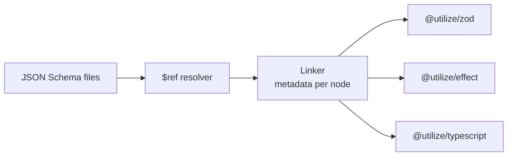

# Architecture

One parser, one linker, three generators.

1. **$ref resolver** resolves every reference: local, external, cyclic.
2. **Linker** annotates each node with metadata (parent, referenced schema, path,
   dialect).
3. **Generators** emit code and types for every standalone schema.
4. **Target specifics** differ where the languages do. Zod breaks cycles with
   getters or `z.lazy()` and derives value types. Effect Schema emits every
   reference through `Schema.suspend` and annotates only the schemas that take
   part in a cycle. The TypeScript generator emits recursive interfaces directly,
   because TypeScript needs no annotation.

The parser, linker and naming rules live in
[`@utilize/json-schema`](../packages/json-schema); each generator is a separate
package that only turns the linked graph into code.
