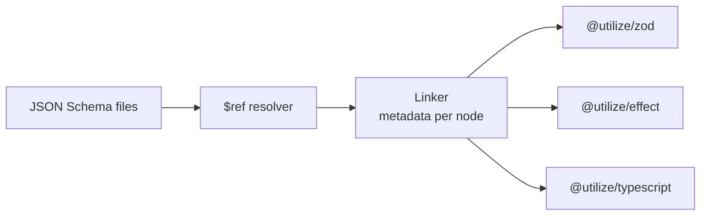

# Architecture

One parser, one linker, three generators.

1. **$ref resolver** resolves every reference: local, external, cyclic.
2. **Linker** annotates each node with metadata (parent, referenced schema, path,
   dialect).
3. **Generators** emit code and types for every standalone schema.
4. **Target specifics** differ where the languages do. Zod breaks cycles with
   getters or `z.lazy()` and derives value types. Effect Schema emits every
   reference through `Schema.suspend` and annotates only the schemas that take
   part in a cycle. The TypeScript generator emits recursive interfaces directly,
   because TypeScript needs no annotation.

## Package layout

[`@utilize/json-schema`](../packages/json-schema) holds everything the three
generators share:

- The **main entry** is browser-safe: parser, linker and metadata, dialect
  detection and keyword policy, name resolution, `collectStandaloneSchemas`,
  which gathers every schema that gets its own declaration together with the
  dependency edges between them, and the target-neutral format validators both
  runtime generators share.
- The **`@utilize/json-schema/node` entry** adds the Node-only helpers behind the
  generator `compile()` functions and their CLIs: reading JSON and YAML,
  file/glob/directory input, `compilePaths`, `parseForCompile`, the generated
  file banner, and `runGeneratorCli` with the flags every CLI accepts.
- `@utilize/zod`, `@utilize/effect` and `@utilize/typescript` add only the code
  emitter and the target-specific handling on top.
